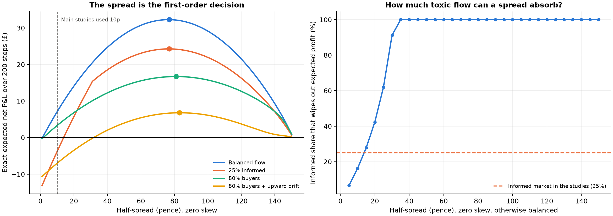

# Market-making simulator: inventory, informed flow and the spread

A Python simulation of a market maker who posts a bid and an ask each step, trades with customers who may or may not know where the price is going, and has to manage the inventory that builds up. The project asks two questions:

1. Does shifting quotes to control inventory ("skew") improve profit or risk?
2. How much of the answer depends on the settings chosen?

It is a synthetic model, not a backtest on market data.

## Results

**Monte Carlo studies ([report](report/REPORT.md)).** At a 10p half-spread, fixed quotes had the highest sample mean P&L in all four markets. More skew reduced inventory and P&L variability but did not consistently reduce losing runs or tail losses. With informed customers, the market maker lost money despite a positive edge at execution: the P&L attribution shows that adverse price moves after informed trades outweigh that edge.

**Exact analysis ([report](report/EXACT_ANALYSIS.md)).** Money is stored in integer pence and inventory is capped at ±3, so (inventory, P&L) is a Markov chain on a finite grid. That means the exact distribution of final P&L can be computed instead of estimated from random runs. Doing so:

- checks the simulations: across the 16 market/skew settings, 12 of the 16 conventional 95% intervals for the sample mean contain the exact mean, and every sample mean is within 2.9 standard errors of it. All four misses are in the informed market, whose settings share the same simulated paths, so they are not independent. The exact engine itself is tested separately against a brute-force enumeration of the simulator's own code;
- shows that the 10p half-spread used in the studies is far below the profit-maximising spread (77–83p);
- shows that at the best spread, skew adds a little in balanced and informed markets (£1.45 and £1.05) and most in the buyer-heavy markets (£4.93 and £9.04).

| Market | Expected P&L at 10p | Best half-spread | Expected P&L at best |
|---|---|---|---|
| Balanced flow | £7.09 | 77p | £32.28 |
| 25% informed | −£3.79 | 77p | £24.27 |
| 80% buyers | £3.32 | 81p | £16.71 |
| 80% buyers + upward drift | −£7.01 | 83p | £6.80 |

The optimum has a one-line explanation. Ignoring inventory, a quote h pence from the reference fills an ordinary customer with probability (151 − h)/301 and earns h − 1 after the 1p fee. Maximising (h − 1)(151 − h) gives h = 76; the exact optimum is a little higher because wider quotes also mean less inventory and lower closing costs.



## How the model works

Each step:

1. The market maker quotes `reference ± half-spread`, shifted by `−inventory × skew`.
2. Any quote that would take inventory past the position limit is withdrawn.
3. One customer arrives. An ordinary customer has a random limit within ±150p of the reference. An informed customer knows the next price move and trades only when it will hurt the market maker.
4. The reference price moves by a coin-flip ±30p, plus optional drift.

At the end, any remaining inventory is closed at a cost. Accounting is in integer pence. The attribution module splits P&L into execution edge + inventory × price change − fees − closing costs and checks that every step reconciles exactly with the ledger; the tests run this check across all four markets.

## Methodology

- **Paired experiments.** Both strategies see identical prices and customers, so a difference cannot come from one strategy seeing luckier scenarios. Sampling noise remains and is reported as a confidence interval.
- **Development/evaluation split.** The selection study chose a skew on 300 development runs per market, saved the choice, then tested it on 500 fresh runs. The risk study was designed afterwards and is labelled as such.
- **Saved protocols.** Each study saves its settings, seeds and SHA-256 hashes of the source files before running. Study scripts refuse to overwrite existing results.
- **Report checks.** The main report builder recomputes every risk-study statistic and interval from the saved per-run records; the exact-analysis builder spot-checks saved values by recomputing them with the exact engine. Both fail on any mismatch.
- **Exact-engine check.** The exact engine is tested against a brute-force enumeration of every possible two-step history, run through the simulator's own functions, and matches to 12 decimal places.

## Repository layout

```
mmsim/          simulator: ledger, prices, customers, strategies, simulation, experiments, attribution, exact
studies/        selection study, risk study, exact analysis, report builders
examples/       short scripts that explore one feature each (costs, limits, stress, informed flow, ...)
tests/          unit tests
results/        saved evidence (protocols and per-run records)
report/         reports and figures
```

## Running it

Python 3.12+.

```sh
python -m venv .venv
source .venv/bin/activate
pip install -r requirements.txt
python -m unittest discover -v
```

Reproduce the studies into new folders (the saved results are in `results/`):

```sh
python -m studies.selection_study --output results/my_selection
python -m studies.risk_study --output results/my_risk
python -m studies.exact_study --output results/my_exact
python -m studies.build_report
python -m studies.exact_report
```

Examples run the same way, e.g. `python -m examples.single_run` or `python -m examples.informed_flow`.

## Limitations

- Prices and customers are synthetic and not calibrated to any market.
- Orders are one share. There is no order book, queue, competition or latency.
- Informed customers have perfect one-step foresight, which is a deliberate stress assumption.
- The exact method relies on the small state space, which comes from integer pence and the ±3 limit.

## Possible extensions

- Calibrate fill probabilities and price moves to real trade data.
- Let the spread adapt to observed toxicity (post-trade price moves).
- Replace the coin-flip price with a continuous-time model and derive optimal quotes (Avellaneda–Stoikov).
