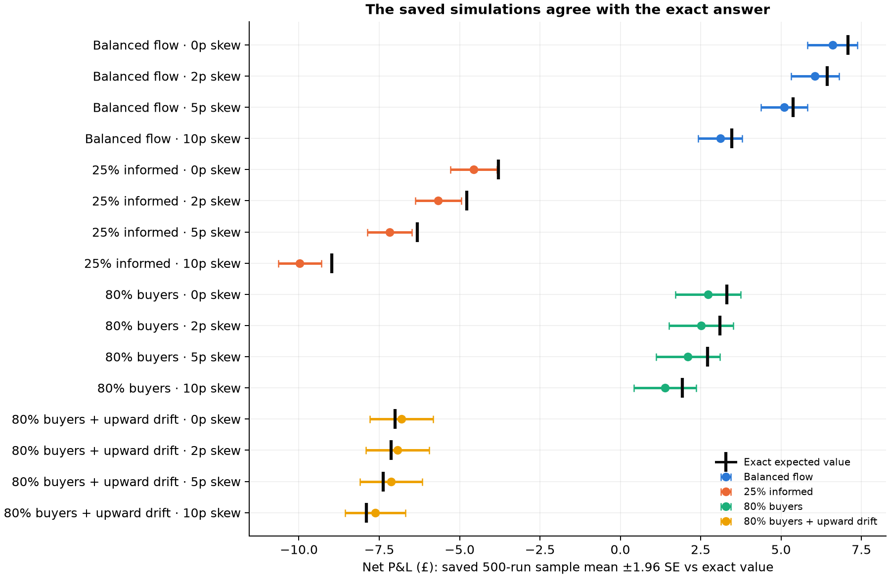
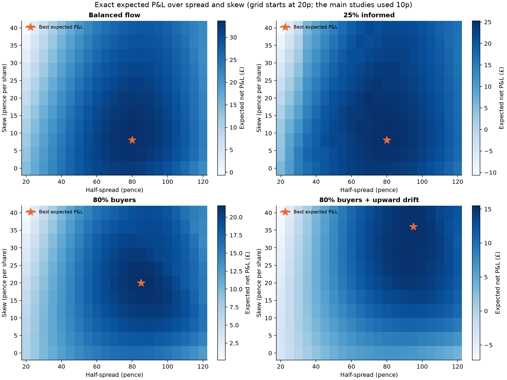
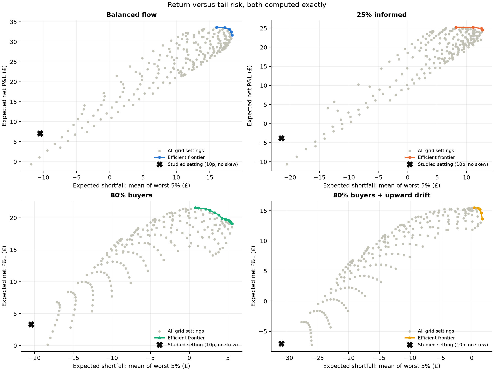

# Exact analysis: the whole P&L distribution, computed rather than simulated

The [simulation studies](REPORT.md) estimated profit and risk from 500 random runs. This analysis computes the *exact* distribution of final P&L for the same market. It changes one of their conclusions.

## Why exact computation is possible

The simulator stores every amount as an integer number of pence. The position limit keeps inventory in {−3, …, 3}, and inventory is the only thing carried from one step to the next. So the pair (inventory, P&L so far) moves on a finite integer grid, and each step's probabilities depend only on the current inventory: it is a **Markov chain**. Start with probability 1 on (0, £0). Each step, every state passes its probability on to the states it can reach. After 200 steps the result is the exact probability of every possible final P&L. That gives exact means, standard deviations, loss probabilities and expected shortfall, with no sampling error.

Within a step, an ordinary customer is independent of the price move, so its fill probability is a simple count: with limits uniform on ±150p, a quote h pence from the reference fills with probability (151 − h)/301. An informed customer knows the move, so the fill and the move are enumerated together. Code: [`mmsim/exact.py`](../mmsim/exact.py). Study: [`studies/exact_study.py`](../studies/exact_study.py). Saved results: [`results/exact_v1`](../results/exact_v1/).

## 1. Checking the engine

- **Against the simulator's own code.** A test enumerates every possible two-step history using the simulator's `Account`, quoting, position-limit and customer functions. It matches the exact distribution outcome by outcome, to 12 decimal places.
- **Two independent calculations.** Forward propagation of the full distribution and a backward recursion for the mean and variance agree to about 1e−12.
- **Against the saved evidence.** For all 16 market/skew settings of the risk study, the saved 500-run sample mean is within 2.90 standard errors of the exact value. 12/16 of the 95% intervals contain it. Settings within one market share the same simulated paths, so these are effectively four independent checks. Sample loss rates, standard deviations, inventory and trade counts also match.



| Market | Skew | Exact mean | Sample mean | Exact SD | Exact loss probability | Sample losing runs | Exact 5% expected shortfall | Sample worst-25 mean |
|---|---|---|---|---|---|---|---|---|
| Balanced flow | 0 | £7.09 | £6.60 | £8.40 | 19.6% | 24.0% | −£10.49 | −£10.65 |
| Balanced flow | 2 | £6.44 | £6.06 | £8.22 | 21.4% | 24.2% | −£10.75 | −£10.69 |
| Balanced flow | 5 | £5.38 | £5.10 | £7.96 | 24.6% | 26.6% | −£11.23 | −£11.02 |
| Balanced flow | 10 | £3.47 | £3.11 | £7.54 | 32.0% | 36.2% | −£12.24 | −£12.14 |
| 25% informed | 0 | −£3.79 | −£4.57 | £8.34 | 67.1% | 70.0% | −£21.50 | −£21.82 |
| 25% informed | 2 | −£4.78 | −£5.66 | £8.21 | 71.7% | 75.4% | −£22.22 | −£22.39 |
| 25% informed | 5 | −£6.32 | −£7.18 | £8.03 | 78.4% | 83.2% | −£23.36 | −£23.50 |
| 25% informed | 10 | −£8.98 | −£9.97 | £7.74 | 87.9% | 91.0% | −£25.41 | −£25.60 |
| 80% buyers | 0 | £3.32 | £2.73 | £11.49 | 38.5% | 40.4% | −£20.45 | −£21.33 |
| 80% buyers | 2 | £3.10 | £2.51 | £11.41 | 39.2% | 40.0% | −£20.50 | −£21.59 |
| 80% buyers | 5 | £2.72 | £2.11 | £11.28 | 40.4% | 42.0% | −£20.62 | −£21.72 |
| 80% buyers | 10 | £1.93 | £1.39 | £11.06 | 43.0% | 44.8% | −£20.94 | −£21.71 |
| 80% buyers + upward drift | 0 | −£7.01 | −£6.80 | £11.54 | 72.7% | 73.2% | −£30.95 | −£29.79 |
| 80% buyers + upward drift | 2 | −£7.14 | −£6.93 | £11.46 | 73.2% | 73.6% | −£30.92 | −£29.67 |
| 80% buyers + upward drift | 5 | −£7.38 | −£7.13 | £11.33 | 74.2% | 74.0% | −£30.90 | −£29.56 |
| 80% buyers + upward drift | 10 | −£7.90 | −£7.62 | £11.10 | 76.1% | 76.0% | −£30.95 | −£29.68 |

## 2. The skew findings, without sampling noise

At the studies' 10p half-spread, more skew lowers the standard deviation in every market. It raises the exact loss probability in every market. It worsens the 5% expected shortfall in 3 of 4 markets and leaves it essentially unchanged in the others. The risk study reported this as "no consistent improvement" in the downside, because small sample differences, such as 40.4% vs 40.0% losing runs, could go either way. The exact numbers settle it: at that spread, skew trades away expected profit and loss frequency in exchange for lower variability.

## 3. The spread was the decision that mattered

Expected P&L as a function of the half-spread (zero skew):

| Market | Exact expected P&L at 10p | Best half-spread | Exact expected P&L at best |
|---|---|---|---|
| Balanced flow | £7.09 | 77p | £32.28 |
| 25% informed | −£3.79 | 77p | £24.27 |
| 80% buyers | £3.32 | 81p | £16.71 |
| 80% buyers + upward drift | −£7.01 | 83p | £6.80 |

A one-line calculation explains the optimum. Ignoring inventory, quoting h pence from the reference earns (h − 1) pence after the 1p fee, with probability (151 − h)/301. Maximising (h − 1)(151 − h) gives **h = 76p**. The exact optimum (77–83p) sits slightly higher, because a wider spread also means fewer fills, less inventory and lower closing costs. The studies' 10p spread filled often but earned little per trade. A wider spread also protects against informed customers: they gain only 30p from a move, so a half-spread above 30p means they never trade at all.


The right-hand chart answers a Glosten–Milgrom-style question: what share of informed customers would push expected profit to zero? At 10p the answer is 16%. The 25% informed market in the studies is beyond that, which is why it lost money. Above 30p, informed customers never trade, so no informed share can make the strategy unprofitable. This depends on the fixed 30p move size, which is a feature of the model.

## 4. With a sensible spread, skew matters again

| Market | Best (half-spread, skew) | Exact expected P&L | Same spread, no skew | Loss probability (best) | 5% expected shortfall (best) |
|---|---|---|---|---|---|
| Balanced flow | (80p, 8p) | £33.66 | £32.21 | 0.0% | £16.02 |
| 25% informed | (80p, 8p) | £25.27 | £24.22 | 0.2% | £8.21 |
| 80% buyers | (85p, 20p) | £21.60 | £16.67 | 1.6% | £0.77 |
| 80% buyers + upward drift | (95p, 36p) | £15.50 | £6.46 | 1.7% | £0.40 |

With wide quotes, fills are rarer and each one matters more. In the buyer-heavy markets, inventory builds up steadily and skew is worth several pounds. The risk study's conclusion that fixed quotes earned most was correct for a 10p spread. It does not hold once the spread is chosen well. The studies tested skew at a single spread far from the optimum, so it could not see this interaction.



Every grid setting has an exact expected P&L and an exact expected shortfall, so the trade-off between them can be drawn as an efficient frontier. The studied setting lies far inside it: there are settings with both higher expected profit and a better worst 5%.



## What this does and does not show

- It is exact **for this synthetic model**: one-share orders, uniform customer limits, ±30p coin-flip prices, perfectly informed customers. It says nothing directly about real markets.
- Choosing the best setting from exact values has no winner's-curse bias, because nothing is sampled. The remaining risk is model risk: the optimum is only as good as the assumptions.
- The method needs a small state space. Here that comes from integer pence and the ±3-share limit. Without a position limit, or with a much longer horizon, the grid grows and simulation becomes the practical tool again.

## Reproduce

```sh
python -m studies.exact_study --output results/my_exact_reproduction   # about 1 minute
python -m studies.exact_report
python -m unittest tests.test_exact -v
```
