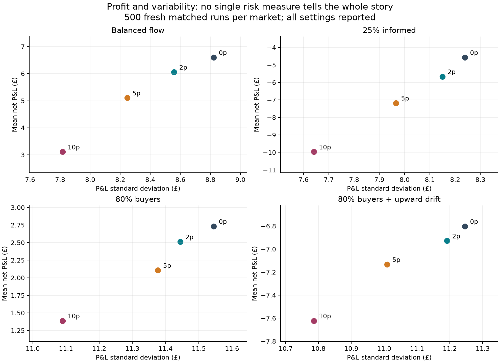
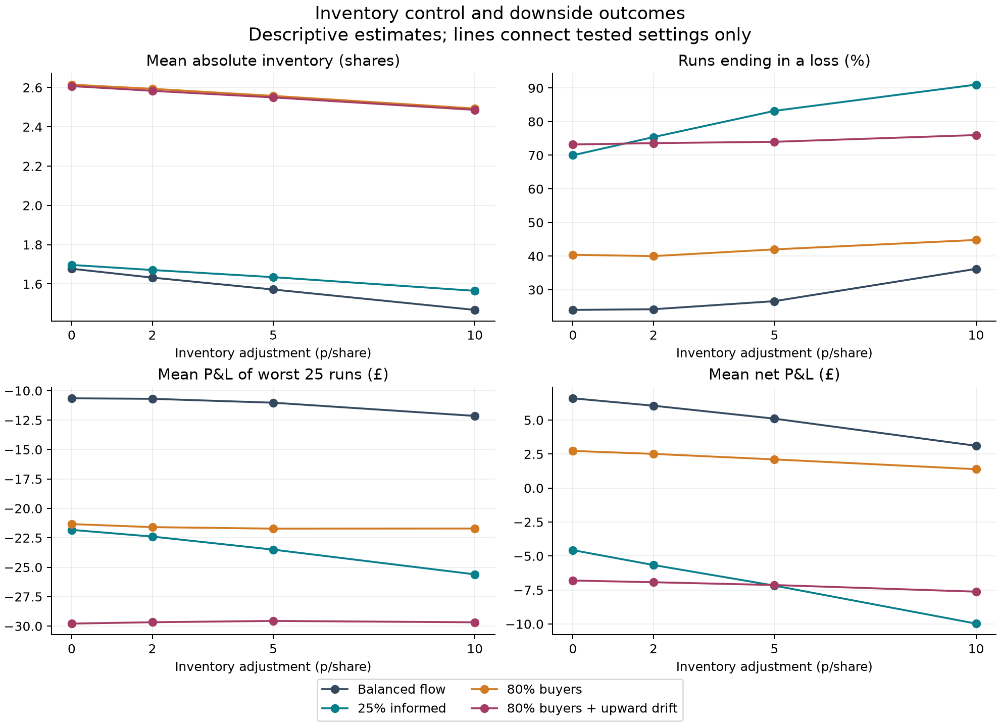
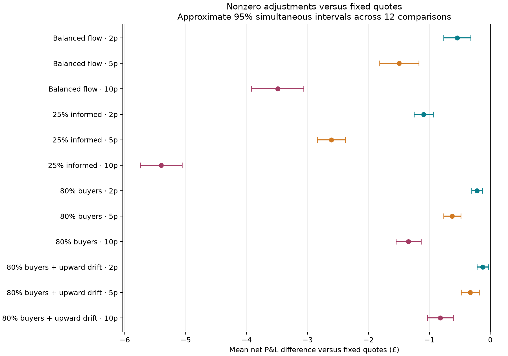

# Inventory-aware market making: profit, risk and model dependence

## Research question

When does shifting quotes to control inventory improve simulated market-making outcomes, and what does that control cost?

## Main findings

In the risk study, fixed quotes had the highest sample mean net P&L in all four markets. Stronger inventory adjustments reduced average absolute inventory and P&L standard deviation, but did not consistently improve loss frequency or worst-tail P&L. This distinguishes exposure control from downside protection.
Exploratory runs in `examples/` with a £1 half-spread found benefits from inventory adjustment under imbalanced customer flow. The main studies used a 10p half-spread. The [exact analysis](EXACT_ANALYSIS.md) later showed why this matters: at 10p the spread, not the skew, is what limits performance.
Informed customers reduced profitability despite positive execution edge. Accounting attribution showed that adverse subsequent price movements could outweigh the price advantage at execution.

## Model and accounting

The account starts with £1,000 and zero inventory. Each step posts one-share bid and ask quotes, reveals one potential customer, executes if acceptable, then updates the reference price. Fixed quotes are reference ± half-spread. Adjusted quotes move their centre by −inventory × skew. Quotes that would breach the position cap are withdrawn before the customer is revealed.
Reference changes are drift plus an equally likely positive or negative shock. Ordinary customer limits are uniformly distributed within ±150p of the current reference. Informed customers know the next reference exactly, buy before rises and sell before falls, using that future reference as their limit. Only the environment/customer receives future information.
All accounting uses integer pence. Net P&L equals execution edge plus post-trade inventory × subsequent price changes, minus customer fees, closing fees and closing execution costs. Step and terminal reconciliations check this against cash + inventory value − starting cash. Inventory P&L includes adverse-selection effects; these are not subtracted twice.

## Study history and evaluation discipline

1. Exploratory scripts (now in `examples/`) developed the model and investigated costs, limits, stress scenarios and informed customers.
2. The selection study compared 0, 2, 5 and 10p/share skew on 300 development runs per market. Highest equal-weight mean net P&L selected zero skew. This choice was saved before 500 fresh evaluation runs per market. Because zero skew equals fixed quoting, the resulting paired zero difference was mechanical, not evidence of general equivalence.
3. After inspecting that evaluation, a separately labelled profit–risk study was designed. It used fresh seeds and reported every candidate rather than selecting another winner. Both studies and their protocols are saved. The risk study is not retroactively presented as the original evaluation.
4. An exact analysis then computed the full P&L distribution for the same market, checking these simulations and extending them beyond the 10p spread ([exact analysis](EXACT_ANALYSIS.md)).

## Risk study design

500 matched runs × 200 steps per market; reference starts at £100; random shocks ±30p; half-spread 10p; cap ±3 shares; fee 1p/share; closing execution cost 10p/share. All terminal inventory is closed. Skews are 0, 2, 5 and 10p/share. Balanced flow is 50% potential buyers; informed flow replaces 25% of potential customers; buyer-heavy conditions use 80% buyers; upward drift is +2p/step.
Each candidate sees identical paths within each market. All candidate/market combinations are reported. Paired mean-difference intervals use a normal approximation with Bonferroni adjustment across 12 nonzero-skew comparisons. Risk statistics are descriptive; no confidence claim is made about their differences. Worst-tail P&L is the mean of the lowest 25 final P&Ls, not a guaranteed loss bound.

### Balanced flow

| Skew (p/share) | Mean net P&L | P&L SD | Losing runs | Worst 25 mean | Mean absolute inventory |
|---|---|---|---|---|---|
| 0 | £6.60 | £8.82 | 24.0% | £-10.65 | 1.68 |
| 2 | £6.06 | £8.56 | 24.2% | £-10.69 | 1.63 |
| 5 | £5.10 | £8.25 | 26.6% | £-11.02 | 1.57 |
| 10 | £3.11 | £7.82 | 36.2% | £-12.14 | 1.47 |

### 25% informed

| Skew (p/share) | Mean net P&L | P&L SD | Losing runs | Worst 25 mean | Mean absolute inventory |
|---|---|---|---|---|---|
| 0 | £-4.57 | £8.24 | 70.0% | £-21.82 | 1.70 |
| 2 | £-5.66 | £8.15 | 75.4% | £-22.39 | 1.67 |
| 5 | £-7.18 | £7.97 | 83.2% | £-23.50 | 1.63 |
| 10 | £-9.97 | £7.64 | 91.0% | £-25.60 | 1.56 |

### 80% buyers

| Skew (p/share) | Mean net P&L | P&L SD | Losing runs | Worst 25 mean | Mean absolute inventory |
|---|---|---|---|---|---|
| 0 | £2.73 | £11.54 | 40.4% | £-21.33 | 2.61 |
| 2 | £2.51 | £11.44 | 40.0% | £-21.59 | 2.59 |
| 5 | £2.11 | £11.38 | 42.0% | £-21.72 | 2.56 |
| 10 | £1.39 | £11.09 | 44.8% | £-21.71 | 2.49 |

### 80% buyers + upward drift

| Skew (p/share) | Mean net P&L | P&L SD | Losing runs | Worst 25 mean | Mean absolute inventory |
|---|---|---|---|---|---|
| 0 | £-6.80 | £11.25 | 73.2% | £-29.79 | 2.61 |
| 2 | £-6.93 | £11.19 | 73.6% | £-29.67 | 2.58 |
| 5 | £-7.13 | £11.01 | 74.0% | £-29.56 | 2.55 |
| 10 | £-7.62 | £10.79 | 76.0% | £-29.68 | 2.49 |

## Limitations

- Synthetic prices and customer behaviour are not calibrated to market data; this is simulation, not historical backtesting.
- No order book, queue position, competition, latency, partial fills, price impact, funding costs or stock-borrow constraints.
- Perfect one-step customer foresight is an artificial stress assumption. Closing assumes unlimited external liquidity at a constant per-share cost.
- A narrow skew grid at a single spread cannot establish good strategies; the exact analysis shows the 10p spread was far from optimal. The profit-only selection objective and artificial market weights reflect research choices.
- New seeds test sampling generalisation within an existing model, not robustness to unknown real-world mechanisms. Confidence intervals omit model uncertainty.
- Lower variability is not automatically preferable when expected profit also falls. Most risk measures here are sample summaries without uncertainty estimates.

## Reproduce and inspect

See the [README](../README.md). Figures and tables are generated from saved results by `studies/build_report.py`; no new simulations or parameter selection occur during report generation. The build checks every summary statistic and adjusted interval against the saved per-run records.
Saved evidence: [selection protocol](../results/selection_v1/protocol.json), [frozen selection](../results/selection_v1/selection.json), [risk protocol](../results/risk_v1/protocol.json), [risk results](../results/risk_v1/results.json).

## Conclusion

At a 10p spread, inventory adjustment is a trade-off rather than an improvement: it reduced exposure and variability at a cost to mean profit, without protecting downside outcomes. The exact analysis shows this conclusion depends on the spread. The project demonstrates why matched experiments, explicit objectives, exact accounting and transparent reporting matter when evaluating a trading rule, and why a single fixed setting can hide the decision that matters most.
